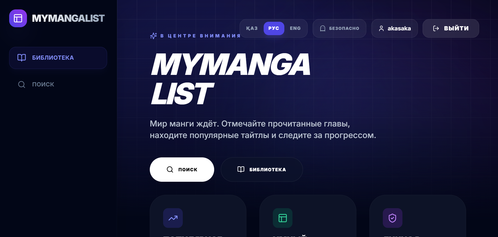
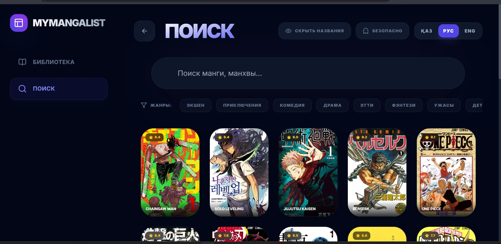
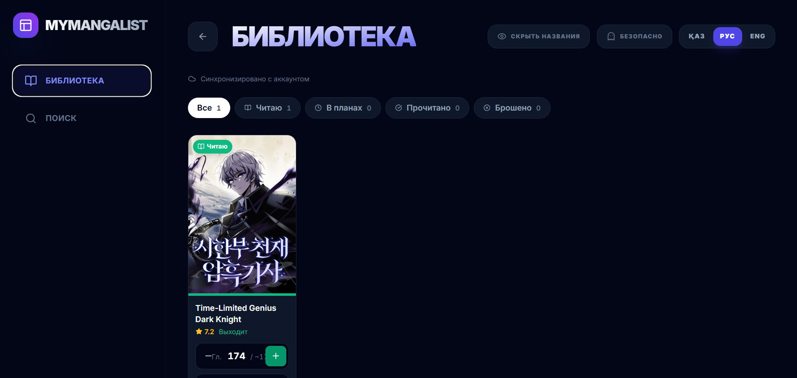

# MyMangaList

A manga / manhwa reading tracker: find series, add them to your library, and keep track of the
chapter you are on — synced across all your devices.

**Live demo:** https://mangalist-for-vercel.vercel.app



| Search | Library |
| --- | --- |
|  |  |

## Features

- **Search** the [AniList](https://anilist.co) catalogue with genre filters, infinite scroll and an
  optional 18+ filter.
- **Library** with statuses (reading, plan to read, completed, dropped), a chapter stepper and a
  progress bar; finishing the last chapter marks the series as completed.
- **Chapter limit for ongoing series.** AniList has no chapter count for series that are still
  running, so a serverless function looks up the latest released chapter on
  [MangaUpdates](https://www.mangaupdates.com) and progress is capped at *latest + 7*.
- **Accounts** with email confirmation, password reset and sign-out (Supabase Auth).
- **Sync between devices.** The library lives in PostgreSQL with Row Level Security and is cached
  locally, so it opens instantly and keeps working offline.
- **Three languages** — Kazakh, Russian, English — switchable at any time; the browser language
  is used on the first visit.
- Responsive layout from phones to wide screens, dark theme.

## Tech stack

| Area | Technology |
| --- | --- |
| Frontend | React 19, TypeScript (strict), Vite, Tailwind CSS, lucide-react icons |
| Auth & database | Supabase Auth, PostgreSQL with Row Level Security |
| Serverless | Vercel Functions (`api/latest-chapter.ts`) with CDN caching |
| External APIs | AniList GraphQL (catalogue), MangaUpdates REST (latest chapters) |
| Hosting | Vercel |

## How it works

```
Browser (React)
 ├─ AniList GraphQL ............ search & metadata
 ├─ Supabase Auth .............. sign-up / sign-in / password reset
 ├─ Supabase Postgres (RLS) .... library_entries, one row per user + manga
 └─ /api/latest-chapter ........ Vercel Function -> MangaUpdates (cached for a day)
```

- **Sync** (`hooks/useLibrarySync.ts`, rules in `lib/librarySync.ts`): the local copy is shown
  first; on sign-in, when the tab gets focus again and when the network returns, the server copy
  is pulled and merged. If the same title was changed on two devices, the newer change wins;
  titles deleted on another device are dropped; titles added offline are kept and uploaded.
  Offline deletions are remembered until the server confirms them.
- **Security:** every table row belongs to a user, and RLS policies let each signed-in user read
  and change only their own rows; anonymous visitors have no access at all. Only the public
  (publishable) Supabase key is used in the browser.
- **Chapter lookup** (`api/latest-chapter.ts`): MangaUpdates does not allow requests from other
  websites, so a small serverless function searches it by the series' English / romaji / native
  titles, matches exact or alternative titles (novels are skipped), and returns the latest chapter.

## Project structure

```
api/latest-chapter.ts          Vercel Function: latest chapter from MangaUpdates
components/                    UI: Dashboard (library), SearchTitle, Auth, MangaModal, ...
hooks/useLibrarySync.ts        pull / merge / push of the library
lib/auth.ts                    Supabase Auth + form validation
lib/librarySync.ts             pure merge & diff logic for sync
lib/libraryRemote.ts           Supabase queries for library_entries
lib/chapters.ts                chapter limit rules
lib/i18n.ts                    languages and detection
supabase/migrations/           SQL for the table and RLS policies
```

## Run locally

Requirements: Node.js 20+ and a free [Supabase](https://supabase.com) project.

```bash
npm install
cp .env.example .env.local   # then fill in the two values, see below
npm run dev                  # http://localhost:5173
npm run build                # type-check + production build
```

### Supabase setup

1. **Project Settings → API**: copy the Project URL and the publishable (anon) key into
   `.env.local` as `VITE_SUPABASE_URL` and `VITE_SUPABASE_ANON_KEY`.
   Never put the `service_role` / secret key into the frontend.
2. **SQL Editor**: run `supabase/migrations/20261106000000_library_entries.sql` to create the
   library table and its RLS policies.
3. **Authentication → URL Configuration**: set *Site URL* to your production URL and add
   `http://localhost:5173` to *Redirect URLs* so confirmation and password-reset links come back
   to the app.

Without these variables the app still runs, but sign-in reports that it is not configured.
`/api/latest-chapter` only runs on Vercel (or `vercel dev`); with plain `npm run dev` ongoing series
simply have no chapter limit.

### Deploying to Vercel

Import the repository, add `VITE_SUPABASE_URL` and `VITE_SUPABASE_ANON_KEY` under
**Settings → Environment Variables** and deploy. Vite inlines these values at build time, so
redeploy after changing them.

## Known limitations

- Chapter limits depend on MangaUpdates and on matching titles; a series that can't be matched
  has no limit. The "latest chapter" there is the latest *translated* chapter.
- Supabase's built-in email sender is rate-limited; a custom SMTP provider is needed for real
  traffic.
- Tailwind is loaded from its CDN, which is fine for a demo but not recommended for production.
